  

Nekogenix lets you transform into a cat and experience life from a neko's perspective.

Here's what we're planning:

- A fun but fairly challenging process of making the neko injection, complete with minigames.
- A long and unique "nekofication" mechanic (or transformation, if you prefer).
- Cat-like abilities, including increased speed, reduced fall damage, and optional night vision.
- Phantoms and creepers won't be a threat anymore.
- And much more!

Currently in development for 1.21.1 NeoForge.

When we bring the mod out of early development, we'll feed you this mod on CurseForge and Modrinth! >:з

## Command permissions

Nekogenix registers its command permissions through the NeoForge permission API. They default to
vanilla operator level 2 when no external permission handler is installed, and can be granted or
denied individually by compatible permission managers such as LuckPerms:

- `nekogenix.command.help`
- `nekogenix.command.status`
- `nekogenix.command.phase.set`
- `nekogenix.command.progress.set`
- `nekogenix.command.progress.next`
- `nekogenix.command.ability.grant`
- `nekogenix.command.ability.revoke`
- `nekogenix.command.lives.set`
- `nekogenix.command.accelerate`
- `nekogenix.command.stabilize`
- `nekogenix.command.reset`
- `nekogenix.command.kit`

LuckPerms wildcard grants such as `nekogenix.command.*` can grant the complete command set.

## License

The code is licensed under the [PolyForm Noncommercial License 1.0.0](LICENSE.md).
