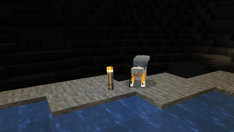
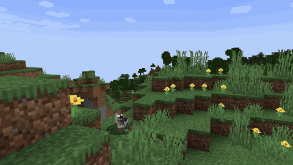
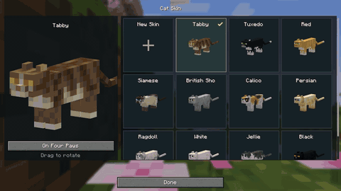

<p align="center">
  <a href="https://nekogenix.github.io/">
    
  </a>
</p>

<p align="center">
  <a href="https://nekogenix.github.io/wiki/">
    
  </a>
  <a href="https://nekogenix.github.io/">
    
  </a>
</p>

<p align="center">
  <a href="https://neoforged.net/">
    
  </a>
</p>

<p align="center">
    <a href="https://liberapay.com/Nekogenix/donate"></a>
</p>

<h2> Minecraft as a cat</h2>

Nekogenix is a Minecraft Java Edition mod for NeoForge. A Neko Injection starts a gradual transformation from human to neko, then into a cat with its own model and animations. You can stop the transformation if you’d rather stay a neko.

Keep mining, building and exploring with your items, armour and elytra. Your inventory stays with you, and your equipment adapts to your cat form.

<p align="center">
  
</p>

<h2> Feline abilities</h2>

- **Double-jump.** Jump again in mid-air. Sprinting and sneaking also become faster.
- **Feline Vision.** See even in complete darkness.
- **Soft Paws.** Take less damage from falls.
- **Feline Scent.** Crouch to find creatures through walls, with different colours showing how dangerous they are.

<p align="center">
  
</p>

Creepers keep their distance, stray cats stop running away from you, and staying awake no longer causes phantoms to spawn. Your smaller body also fits through one-block gaps.

In Survival, [nine lives](https://nekogenix.github.io/wiki/transformation/#lives) let you keep your feline form through eight deaths. The ninth returns you to human form.

<h2> Laboratory and transformation</h2>

The laboratory adds syringes, saliva samples, nucleocards, a centrifuge and a pneumatic stand. Use them to [prepare a Neko Injection](https://nekogenix.github.io/wiki/laboratory/#pneumatic). Your abilities appear gradually as the transformation progresses.

A stabilizer lets you [stop before the final change](https://nekogenix.github.io/wiki/transformation/#stabilize) and keep your neko form, including the ears and abilities.

<p align="center">
  
</p>

<h2> Cat skins</h2>

Choose a vanilla cat coat or [import your own skin](https://nekogenix.github.io/wiki/cat-skins/#file). The in-game menu lets you preview it on your cat. Your selected skin also changes the colours of your ears in neko form.

<p align="center">
  
</p>

<h2> Installation</h2>

1. Download a `.jar` from [GitHub Releases](https://github.com/nekogenix/nekogenix-mod/releases) for your Minecraft version.
2. Install NeoForge for the same Minecraft version.
3. Put the mod’s `.jar` in your game instance’s `mods` folder.

For multiplayer, install Nekogenix on the server and on each player’s client. The [installation guide](https://nekogenix.github.io/wiki/getting-started/) covers the official launcher, Prism Launcher, Modrinth App and CurseForge App.

CurseForge and Modrinth releases are coming soon.

<details>
<summary>Building from source</summary>

Clone this repository and use the Java toolchain specified in [build.gradle](https://github.com/nekogenix/nekogenix-mod/blob/main/build.gradle).

On Linux or macOS:

```sh
./gradlew build
```

On Windows:

```powershell
.\gradlew.bat build
```

The built `.jar` is in `build/libs/`.

</details>

<h2> License</h2>

- **Code:** [PolyForm Noncommercial License 1.0.0](https://github.com/nekogenix/nekogenix-mod/blob/main/LICENSE.md#code-license).
- **Assets under `src/main/resources/assets/`:** [All Rights Reserved](https://github.com/nekogenix/nekogenix-mod/blob/main/LICENSE.md#assets-license), Rudator and Wechirok.
